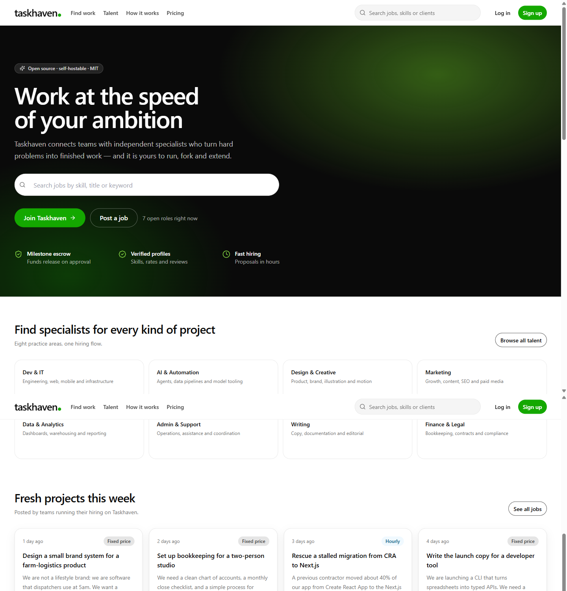
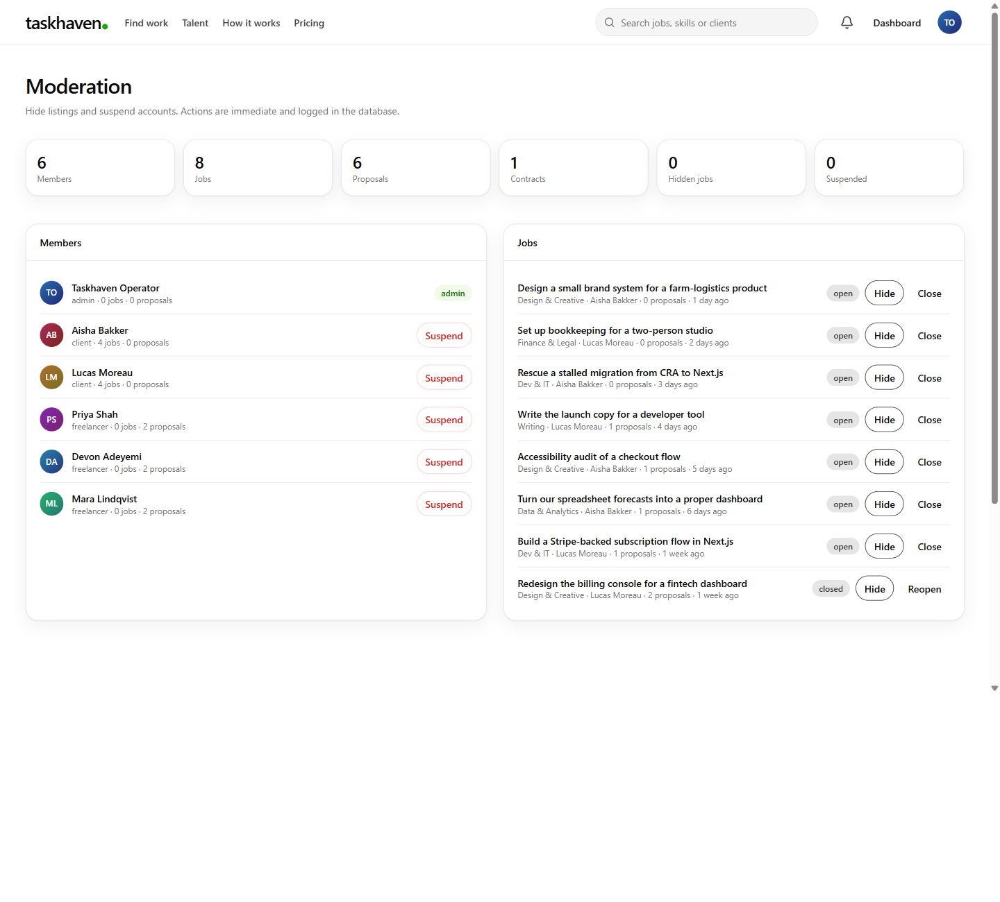

# Taskhaven

**An open-source freelance marketplace you can self-host.** Post work, compare proposals, run contracts with
milestones, message in context, and record every payment in a ledger — all in one Next.js application.

[](https://github.com/freshlesh3/taskhaven/actions/workflows/ci.yml)
[](./LICENSE)
[](https://nextjs.org)

> **Status: early but usable.** The core hiring loop works end to end. Payments are simulated (no money moves).
> Not affiliated with Upwork or any other marketplace.



The moderation console, available to accounts with the `ADMIN` role:



## Why

Marketplace software is usually either a closed SaaS product or a thin directory. Taskhaven is the middle: a real
application with accounts, jobs, proposals, contracts, milestones, messages, reviews and a ledger — and no
proprietary dependency in the critical path. Fork it for a niche marketplace, an agency bench, or a co-op.

## Features

- **Accounts and sessions** — email + password auth, bcrypt hashes, database-backed sessions, hashed session tokens.
- **Two-sided profiles** — one account can hire and work; public profiles with skills, rates, availability and reviews.
- **Jobs** — post a brief with budget type, range, experience level, duration and skills; browse and filter by
  category, budget and level, with keyword search across titles, descriptions and skills.
- **Proposals** — cover letter, bid and delivery window; revise before hiring; shortlist, hire or decline.
- **Contracts** — created on hire, with milestones, a message thread and status tracking.
- **Simulated escrow** — funding and releases are recorded per milestone, net of a configurable 10% fee.
- **Reviews** — unlocked when a contract completes, shown on the recipient's profile.
- **Dashboards** — client and freelancer views: active contracts, open jobs, proposals out, released earnings.
- **Notifications** — in-app inbox with unread counts and deep links to the record that changed.
- **Moderation** — an admin console to hide jobs, suspend accounts (sessions revoked) and close listings.
- **Account safety** — password change revokes every other session; suspended accounts cannot sign in.
- **Ops endpoints** — `/api/health` reports database connectivity for uptime checks.

## Quick start

```bash
git clone https://github.com/freshlesh3/taskhaven.git
cd taskhaven
cp .env.example .env
npm install
npm run db:push
npm run db:seed
npm run dev
```

Open <http://localhost:3000>. The seed creates eight jobs, six proposals and one live contract.

### Demo accounts

| Role       | Email                  | Password      |
| ---------- | ---------------------- | ------------- |
| Freelancer | `mara@taskhaven.dev`   | `password123` |
| Freelancer | `devon@taskhaven.dev`  | `password123` |
| Freelancer | `priya@taskhaven.dev`  | `password123` |
| Client     | `lucas@taskhaven.dev`  | `password123` |
| Client     | `aisha@taskhaven.dev`  | `password123` |
| Admin      | `admin@taskhaven.dev`  | `password123` |

The login screen has one-click buttons for the seeded accounts. **Delete these accounts before exposing an instance
to the internet.**

## Scripts

| Command            | What it does                                              |
| ------------------ | --------------------------------------------------------- |
| `npm run dev`      | Development server with hot reload                        |
| `npm run build`    | Production build (type-checks and lints)                  |
| `npm start`        | Serve the production build                                |
| `npm run typecheck`| `tsc --noEmit`                                            |
| `npm test`         | Vitest unit tests (money, validation, helpers)            |
| `npm run db:push`  | Apply the Prisma schema to the database                   |
| `npm run db:seed`  | Reset the demo dataset                                    |
| `npm run db:reset` | Drop, recreate and reseed                                 |

## Architecture

```
prisma/schema.prisma      data model (SQLite by default, PostgreSQL-ready)
src/lib                   auth, money, validation, constants, helpers
src/server/actions        mutations — every action re-checks the session and ownership
src/server/queries.ts     read queries used by pages
src/app                   routes (App Router, server components by default)
tests/                    Vitest unit tests
docs/                     architecture, payments, roadmap
```

- **Server components** fetch directly through Prisma; **server actions** validate input with Zod, authorise, then
  mutate and revalidate paths.
- **Money** is stored as integer minor units and formatted only at the edge (`src/lib/money.ts`).
- **Auth** is deliberately small: no third-party identity provider, so the whole flow is readable in
  `src/lib/auth.ts` and `src/server/actions/auth.ts`.

More detail in [`docs/architecture.md`](./docs/architecture.md) and [`docs/payments.md`](./docs/payments.md).

## PostgreSQL

The schema avoids SQLite-only types. To switch:

1. Set `provider = "postgresql"` in `prisma/schema.prisma`.
2. Point `DATABASE_URL` at your database (see `docker-compose.yml`).
3. Run `npm run db:push && npm run db:seed`.

## Roadmap

Tracked in [`docs/roadmap.md`](./docs/roadmap.md). Highlights: organisations and teams, file attachments, email
notifications, real payment adapters, saved searches, and an admin/moderation surface.

## Contributing

Issues and pull requests are welcome — see [`CONTRIBUTING.md`](./CONTRIBUTING.md). Security reports: see
[`SECURITY.md`](./SECURITY.md).

### Enabling CI

The workflow lives at [`docs/ci/github-actions.yml`](./docs/ci/github-actions.yml) so it can be reviewed like any other
file. To activate it, copy it into place and push with a token that has the `workflow` scope:

```bash
mkdir -p .github/workflows
cp docs/ci/github-actions.yml .github/workflows/ci.yml
git add .github/workflows/ci.yml && git commit -m "ci: enable the verification workflow"
# a token without the `workflow` scope cannot push this path:
gh auth refresh -s workflow
git push
```

It runs typecheck, unit tests and a production build on every push and pull request.

## License

[MIT](./LICENSE). Taskhaven is an independent project, not affiliated with or endorsed by Upwork. All code, copy and
branding in this repository are original; other companies' names and logos belong to their owners.
